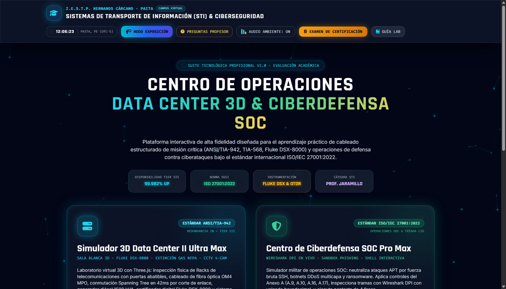
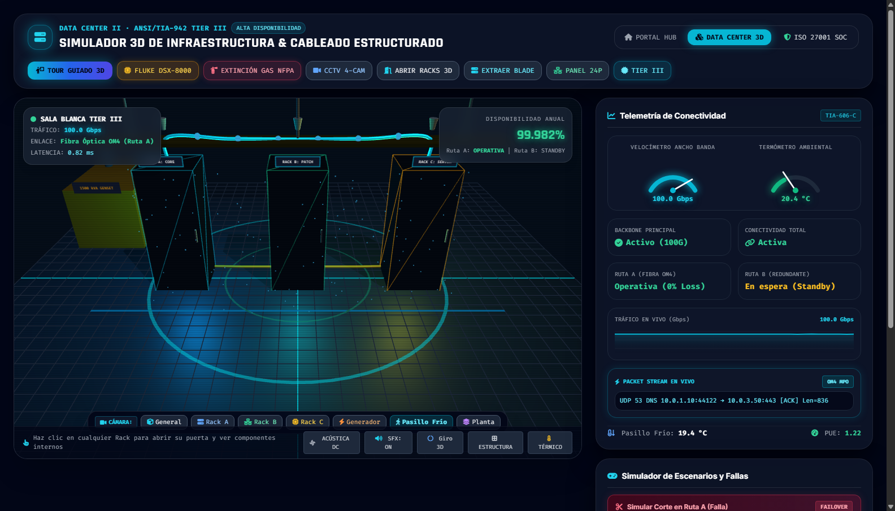
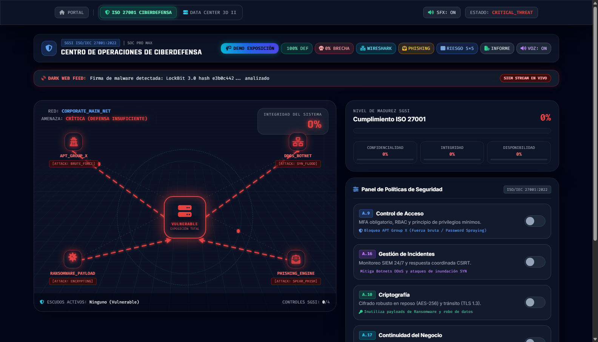

# 🏢 Suite Tecnológica de Centro de Datos Tier III & SOC de Ciberdefensa ISO/IEC 27001

[](https://gmph2007.github.io/simulador-datacenter-4d-seguridad-ciberseguridad/)
[](https://gmph2007.github.io/simulador-datacenter-4d-seguridad-ciberseguridad/datacenter.html)
[](https://gmph2007.github.io/simulador-datacenter-4d-seguridad-ciberseguridad/ciberdefensa.html)
[](https://gmph2007.github.io/simulador-datacenter-4d-seguridad-ciberseguridad/datacenter.html)
[](https://gmph2007.github.io/simulador-datacenter-4d-seguridad-ciberseguridad/datacenter.html)
[](https://gmph2007.github.io/simulador-datacenter-4d-seguridad-ciberseguridad/ciberdefensa.html)
[](https://cdnjs.cloudflare.com/ajax/libs/three.js/r128/three.min.js)
[](https://gmph2007.github.io/simulador-datacenter-4d-seguridad-ciberseguridad/)
[](LICENSE)

---

## 🏛️ Identificación Institucional y Académica

* **Institución:** Instituto de Educación Superior Tecnológico Público **"Hermanos Cárcamo"** (Paita, Piura, Perú).
* **Programa de Estudios:** Arquitectura de Plataformas y Servicios de Tecnologías de la Información.
* **Unidad Didáctica:** Sistemas de Transporte de Información (STI) / Seguridad Informática y Auditoría de TI.
* **Docente Especialista:** **Dr. Javier Eduardo Jaramillo Atoche** *(Doctor en Tecnologías de la Información y Comunicaciones - SUNEDU)*.
* **Líder y Desarrollador Principal:** **Gerson Misael Pintado Huamán** *(Arquitectura de Software, Modelado 3D Three.js, Shaders, Telecomunicaciones & Ciberdefensa)*.
* **Equipo de Investigación y Colaboración Académica:**
  1. **Gerson Misael Pintado Huamán** *(Arquitectura Global, Telecomunicaciones & Simulación 3D)*
  2. **Manuel Danilo López Garay** *(Análisis de Redes y Seguridad Lógica)*
  3. **Mariana Juliet Clavijo Pinzón** *(Evaluación de Riesgos y Matriz ISO 27001)*
  4. **Pedro Miguel Aguilar Flores** *(Infraestructura Eléctrica y Climatización TIA-942)*
  5. **Dayron Antonio Urbina Zapata** *(Sistemas Biométricos y Vigilancia CCTV)*

---

## 🌐 Enlaces de Acceso Inmediato en la Nube (GitHub Pages)

Todos los módulos están desplegados en tiempo real y son 100% interactivos desde cualquier navegador web (computadora, tablet o móvil), sin requerir instalación de programas ni servidores locales:

| Recurso | Enlace Directo | Descripción Funcional |
| :--- | :--- | :--- |
| **🚀 Portal Maestro Hub** | [**Abrir Portal Maestro**](https://gmph2007.github.io/simulador-datacenter-4d-seguridad-ciberseguridad/) | Centro de mando unificado, Modo Exposición (6 diapositivas para proyector), balotario de preguntas de defensa, examen de certificación con diploma imprimible, **Calculadora Oficial de Rúbrica Nota 20** y sintetizador de audio ambiental. |
| **🏢 Simulador 3D Data Center II Ultra Max** | [**Abrir Simulador 3D**](https://gmph2007.github.io/simulador-datacenter-4d-seguridad-ciberseguridad/datacenter.html) | Arquitectura física ANSI/TIA-942 Tier III, 3 racks 42U interactivos con apertura de puertas de cristal, servidor blade hot-swap, certificador Fluke DSX-8000, **Reflectómetro Óptico OTDR**, **Tablero ATS & Generador Diésel 1500 kVA**, failover STP y CCTV 4-canales. |
| **🛡️ Centro de Ciberdefensa SOC ISO 27001** | [**Abrir SOC Ciberdefensa**](https://gmph2007.github.io/simulador-datacenter-4d-seguridad-ciberseguridad/ciberdefensa.html) | Arena de ciberseguridad con 4 actores de amenazas simétricos en esquinas, conductos vectoriales SVG con flechas pulsantes, escudos ISO 27001:2022 (A.9, A.10, A.16, A.17), **Matriz MITRE ATT&CK v14**, **Terminal Interactiva SHELL CLI**, **Línea de Tiempo CSIRT**, Wireshark DPI y sandbox de phishing. |
| **🗺️ Mapa Conceptual Interactivo** | [**Abrir Mapa Conceptual**](https://gmph2007.github.io/simulador-datacenter-4d-seguridad-ciberseguridad/MAPA_CONCEPTUAL_INTERACTIVO.html) | Dashboard dinámico de conceptos clave de seguridad física, climatización y transporte de información. |
| **📄 Monografía Completa (PDF)** | [**Descargar Informe PDF**](docs/TRABAJO_DATA_CENTER_PRO_MAX.pdf) | Documento académico formal con rúbrica, análisis de casos y matrices de ingeniería. |

---

## 📸 Galería Visual de la Suite

<div align="center">

### 1. Portal Maestro Hub & Centro de Certificación


### 2. Simulador 3D Data Center Tier III (ANSI/TIA-942, Fluke DSX-8000 & OTDR)


### 3. Centro de Ciberdefensa SOC ISO/IEC 27001:2022 & Matriz MITRE ATT&CK


</div>

---

## 🔬 Arquitectura y Nuevos Módulos del Ecosistema

### 1. 🚀 Módulo 1: Portal Maestro Hub (`index.html` / `portal.html`)
El punto de entrada central diseñado para la presentación oficial y evaluación académica:
* **Calculadora Oficial de Rúbrica de Sustentación (SUNEDU / Dr. Jaramillo):** Evaluador interactivo con 4 sliders ponderados (0-5 pts c/u) que computa la calificación vigesimal final (0-20 pts) y emite el dictamen formal (*Summa Cum Laude* para notas de 19-20), con botón para impresión del acta oficial.
* **Laboratorio de Audio DSP Nativo:** Consola interactiva de síntesis de señales acústicas que permite disparar tonos senoidales, cuadrados y de sierra para emular los generadores de tono de laboratorio.
* **Modo Proyector para Exposición:** Presentación interactiva en pantalla completa de 6 diapositivas técnicas diseñadas específicamente para la sustentación ante el **Dr. Javier Eduardo Jaramillo Atoche**, con control mediante teclado:
  * `[→]` / `[Espacio]`: Diapositiva siguiente.
  * `[←]`: Diapositiva anterior.
  * `[Esc]`: Salir del modo proyector.
* **Balotario de Defensa Oral:** Banco con las 6 preguntas técnicas más rigurosas sobre cálculo de atenuación óptica, diafonía NEXT en Cat 6A, contención térmica de pasillos, mantenimiento concurrente Tier III y controles de ciberdefensa.
* **Examen de Certificación & Diploma de Excelencia:** Evaluación aleatoria de conocimientos técnicos que, al ser aprobada, genera automáticamente un **Certificado Oficial de Excelencia Académica** con sello digital, fecha dinámica, firma del estudiante y botón para impresión/exportación a PDF.
* **Reloj Digital Nacional:** Sincronizado en tiempo real con la hora oficial de Perú (UTC-5, Lima / Paita).

---

### 2. 🏢 Módulo 2: Simulador 3D Data Center II Ultra Max (`datacenter.html`)
Simulador de ingeniería en 3D basado en **Three.js** y estándares internacionales de telecomunicaciones:
* **Reflectómetro Óptico de Dominio Temporal (OTDR):**
  * Instrumento de reflectometría óptica integrado en el panel de distribución con selección de longitud de onda (`850 nm OM4` vs `1310 nm OS2`).
  * Gráfica SVG de retrodispersión Rayleigh y picos de reflexión de Fresnel en tiempo real: Conector ODF (0m), Empalme troncal MPO (24m) y Transceptor Blade HBA (48.2m).
  * Parámetros: Longitud medida (`48.25 m`), Pérdida por inserción (`0.26 dB`), Pérdida de retorno óptico (`> 48.5 dB`) y dictamen de cumplimiento bajo norma ANSI/TIA-568.3-D (**PASA +1.24 dB**).
* **Tablero de Transferencia Automática (ATS) & Grupo Electrógeno Diésel 1500 kVA:**
  * Cuadro de mando eléctrico con simulación de corte de acometida comercial ENOSA (380V/220V Trifásico).
  * Transferencia estática instantánea (STS) en 0 ms asumida por banco de baterías UPS 2N.
  * Tacómetro digital de aceleración del motor Caterpillar 3512B de 0 a 1800 RPM (60.0 Hz) suministrando 840 kW de carga continua.
* **Clasificación ANSI/TIA-942 Tier III:** Disponibilidad del 99.982% (máximo 1.6 horas de inactividad anual) con topología de **Mantenimiento Concurrente** (*Concurrent Maintainability*).
* **Racks 42U de Alta Fidelidad Visual:**
  * **Rack A (Core / ODF):** Distribuidor de Fibra Óptica OM4 50/125 $\mu$m con conectores MPO/LC troncales de 100 Gbps y conmutación STP redundante.
  * **Rack B (Distribución Horizontal):** Patch panel modular de 24 puertos Cat 6A según norma ANSI/TIA-568.2-D con esquema de crimpado T568B e inspección puerto a puerto.
  * **Rack C (Cómputo Blade):** Chasis modular con servidor blade extraíble en caliente (*Hot-Swap*) con animación 3D de eyección e inserción en vivo.
  * **Puertas de Cristal y Señalización 3D:** Puertas de vidrio tintado con apertura dinámica (`toggleRackDoor`), etiquetas flotantes luminosas de alta resolución sobre cada rack, barras beacon RGB y LEDs parpadeantes de actividad por cada unidad de servidor.
* **Analizador de Redes Fluke DSX-8000 CableAnalyzer™:**
  * Curva paramétrica interactiva de diafonía NEXT (*Near-End Crosstalk*) y Pérdida de Retorno (*Return Loss*) frente al límite normativo.
  * Mapeo de hilos 1:1 en tiempo real con simulación de 4 fallas físicas inyectables: Par Dividido (*Split Pair*), Cable Cruzado (*Miswire*), Par Abierto (*Open Pair*) y Destrenzado Excesivo (*Excessive Untwist*).
  * Generador de **Reporte Oficial de Certificación Fluke** con formato de impresión formal.
* **Bandeja Portacables & Conmutación STP:** Bandeja aérea con fibra óptica luminosa. El botón *Corte de Fibra* simula una ruptura en la Ruta Primaria A y demuestra la conmutación autónoma en menos de 50 ms a la Ruta B mediante Rapid Spanning Tree Protocol (IEEE 802.1w).
* **Sistema de Extinción de Incendios NFPA 2001:** Descarga de gas limpio (Inergen / Novec 1230) con temporizador regresivo de evacuación de 10 segundos y pulsador de paro de emergencia (*EPO Abort*).
* **Dársena de Cámaras 3D:** Barra dock en píldora de vidrio con 7 ángulos predeterminados: General Isométrica, Rack A, Rack B, Rack C, Grupo Electrógeno, Pasillo Frío y Planta Cenital.

---

### 3. 🛡️ Módulo 3: Centro de Ciberdefensa SOC ISO/IEC 27001:2022 (`ciberdefensa.html`)
Plataforma de simulación de ciberataques y mitigación defensiva en tiempo real:
* **Matriz MITRE ATT&CK Enterprise v14 Integrada:**
  * Mapeo formal de Tácticas y Técnicas para cada actor de amenaza:
    * `APT_GROUP_X`: T1190 (Exploit Public-Facing App) / T1071.001 (Web Protocols C2) $\rightarrow$ **Control A.9 (MFA & Zero Trust)**.
    * `DDOS_BOTNET`: T1498.001 (Direct Network Flood - SYN/UDP) $\rightarrow$ **Control A.16 (Radar SIEM & Scrubbing)**.
    * `RANSOMWARE_PAYLOAD`: T1486 (Data Encrypted for Impact) / T1490 $\rightarrow$ **Control A.10 (Criptografía AES-256) & Control A.17 (Respaldo Inmutable WORM)**.
    * `PHISHING_ENGINE`: T1566.001 (Spearphishing Attachment) $\rightarrow$ **Control A.7.2.2 (Concienciación & Sandbox CSIRT)**.
* **Consola Interactiva SOC Analyst Terminal CLI (Bash v5.2):**
  * Shell embebido interactivo con prompt `soc@carcamo:~$` que permite ejecutar comandos de consola: `help`, `status`, `mitigate <a9|a10|a16|a17|all>`, `scan`, `wireshark`, `phishing`, `mitre`, `audit`, `clear`, `exit`.
* **Línea de Tiempo de Respuesta ante Incidentes CSIRT (ISO/IEC 27035):**
  * Flujo procedimental estructurado en 5 fases críticas: Detección & Triage, Contención Inmediata, Erradicación del Vector, Recuperación de la Continuidad y Lecciones Aprendidas.
* **Distribución Simétrica de Amenazas en 4 Esquinas:**
  * **Top-Left (Noroeste):** `APT_GROUP_X` (Exfiltración sigilosa C2 sobre HTTPS / Puerto 443).
  * **Top-Right (Noreste):** `DDOS_BOTNET` (Inundación volumétrica SYN/UDP Flood masiva).
  * **Bottom-Left (Suroeste):** `RANSOMWARE_PAYLOAD` (Cifrado malicioso de almacenamiento y base de datos).
  * **Bottom-Right (Sureste):** `PHISHING_ENGINE` (Campañas dirigidas de Spear-Phishing y BEC).
* **Conductos Vectoriales SVG con Flechas Pulsantes:** Capa matemática de láseres de ataque con cabezas de flecha direccionales (`#arrow-red`, `#arrow-blue`, `#arrow-purple`, `#arrow-emerald`) y paquetes de energía cinéticos que viajan a través de los conductos hacia el servidor central.
* **Escudos de Mitigación ISO/IEC 27001 Interactivos:**
  * **Control A.9 (Control de Acceso Lógico):** Escudo azul rotativo con Zero Trust y MFA que bloquea la exfiltración de APT_GROUP_X y conmuta el láser a azul.
  * **Control A.16 (Gestión de Incidentes de Seguridad):** Radar de barrido cónico SIEM que detecta y disipa la inundación de DDOS_BOTNET convirtiendo el haz en púrpura.
  * **Control A.10 (Criptografía y Cifrado Fuerte):** Escudo esmeralda de cifrado AES-256-GCM que neutraliza el cifrado no autorizado de RANSOMWARE y torna el conducto a verde.
  * **Control A.17 (Redundancia y Respaldo DRP):** Activación de sincronización espejo en caliente hacia el Servidor Secundario de Contingencia (DRP Mirror).
* **Inspector Wireshark DPI Integrado:** Captura y desglose de tramas Ethernet II, IPv4, TCP/UDP y carga útil binaria en hexadecimal/ASCII.
* **Sandbox CSIRT de Phishing:** Simulador de cliente de correo donde el usuario evalúa correos sospechosos y aplica acciones de aislamiento, reporte a CSIRT o cuarentena.
* **Matriz de Riesgo 5x5:** Cuadrícula de probabilidad vs. impacto con clasificación de severidad y cálculo dinámico de riesgo residual.
* **Generador de Informe de Auditoría:** Reporte ejecutivo con estado de cumplimiento de los 93 controles de la norma ISO/IEC 27001:2022.

---

## ⌨️ Atajos de Teclado y Controles de Navegación

| Tecla / Acción | Módulo Activo | Efecto en la Simulación |
| :---: | :--- | :--- |
| `[→]` / `[Espacio]` | Portal Maestro (Modo Presentación) | Avanzar a la siguiente diapositiva técnica. |
| `[←]` | Portal Maestro (Modo Presentación) | Retroceder a la diapositiva anterior. |
| `[Esc]` | Todos los módulos | Cerrar modales abiertos (Fluke, OTDR, ATS, MITRE, Wireshark, Examen, etc.). |
| **Arrastrar Clic Izq.** | Simulador 3D Data Center | Rotación orbital libre de la cámara en 3D. |
| **Arrastrar Clic Der.** | Simulador 3D Data Center | Desplazamiento panorámico (*Pan*) de la sala. |
| **Rueda de Ratón** | Simulador 3D Data Center | Acercamiento / alejamiento (*Zoom in/out*). |
| **Clic en Rack 3D** | Simulador 3D Data Center | Abre la puerta del rack seleccionado y despliega sus especificaciones. |

---

## 📂 Estructura Limpia del Repositorio

```bash
├── index.html                               # Portal Maestro Hub (Página de inicio en GitHub Pages)
├── portal.html                              # Alias de compatibilidad del Portal Maestro
├── datacenter.html                          # Simulador 3D Data Center Tier III (ANSI/TIA-942, Fluke & OTDR)
├── ciberdefensa.html                        # Centro de Ciberdefensa SOC (ISO/IEC 27001:2022, MITRE & CLI)
├── iniciar_simuladores.bat                  # Lanzador automático en 1 clic para Windows
├── MAPA_CONCEPTUAL_INTERACTIVO.html        # Mapa conceptual dinámico complementario
├── SIMULADOR_DATA_CENTER_3D.html            # Versión de archivo histórico del simulador
├── README.md                                # Documentación técnica y académica integral
├── LICENSE                                  # Licencia de código abierto MIT
├── .gitignore                               # Configuración de exclusiones de Git
│
├── assets/                                  # Capturas HD, diagramas y recursos gráficos
│   ├── screenshot_portal.png                # Captura oficial del Portal Maestro Hub
│   ├── screenshot_datacenter.png            # Captura oficial del Simulador 3D Data Center
│   ├── screenshot_ciberdefensa.png          # Captura oficial del Centro de Ciberdefensa SOC
│   ├── datacenter_seguridad_fisica.jpg      # Render de infraestructura física
│   ├── datacenter_seguridad_logica.jpg      # Render de seguridad lógica y redes
│   └── mapa_conceptual_datacenter_hd.png    # Mapa conceptual en alta definición
│
├── docs/                                    # Documentación formal y monografías
│   ├── TRABAJO_DATA_CENTER_PRO_MAX.pdf      # Informe académico final en formato PDF
│   ├── TRABAJO_DATA_CENTER_PRO_MAX.docx     # Informe editable en Microsoft Word
│   ├── MANUAL_TECNICO_SIMULADOR_3D.md       # Manual de ingeniería y Three.js
│   ├── GUIA_DE_EXPOSICION_RAPIDA.md         # Guion de defensa oral para la exposición
│   └── Caso_Practico_Seguridad_DataCenter.md# Análisis de casos prácticos y contingencias
│
└── src/                                     # Scripts de generación y herramientas complementarias
    ├── make_simulator_html.py               # Generador automatizado de plantillas
    ├── generar_mapa_hd.py                   # Generador del mapa conceptual
    └── crear_doc_datacenter.py              # Generador de documentos Word/PDF
```

---

## 🛠️ Instalación y Ejecución Local

El proyecto es completamente **autónomo y *zero-dependency*** (no requiere Node.js, Python, bases de datos ni servidores web locales):

### Opción A: Ejecución Directa en Windows (Recomendada)
1. Descargue el repositorio o clone mediante Git:
   ```bash
   git clone https://github.com/GMPH2007/simulador-datacenter-4d-seguridad-ciberseguridad.git
   ```
2. Haga doble clic en el archivo `iniciar_simuladores.bat`.
3. Automáticamente se abrirán los tres módulos en pestañas organizadas de su navegador web por defecto.

### Opción B: Ejecución Manual
Simplemente abra `index.html` con cualquier navegador moderno (Google Chrome, Microsoft Edge, Mozilla Firefox, Brave u Opera).

---

## 📜 Licencia y Acreditación

Este proyecto ha sido desarrollado con fines de excelencia académica, investigación tecnológica y divulgación científica para el **I.E.S.T.P. "Hermanos Cárcamo" - Paita**, bajo la cátedra del **Dr. Javier Eduardo Jaramillo Atoche**. Distribuido bajo los términos de la [Licencia MIT](LICENSE).

**© 2026 Gerson Misael Pintado Huamán y Equipo de Investigación.**  
*Arquitectura de Plataformas y Servicios de Tecnologías de la Información · Paita, Perú.*
